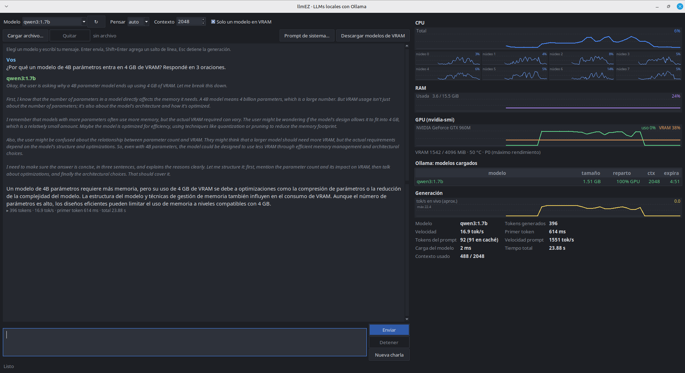
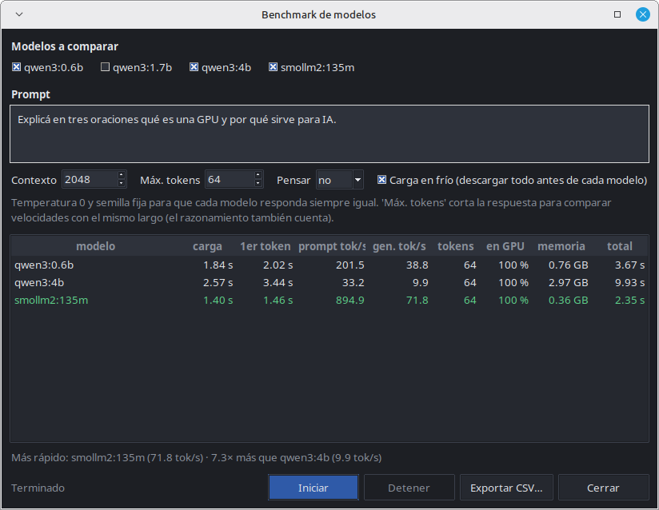

# llmEZ

App de escritorio en Python para experimentar con modelos de lenguaje locales que corren en [Ollama](https://ollama.com): un chat con streaming a la izquierda y un monitor en tiempo real de CPU, RAM, GPU y velocidad de generación a la derecha.

Es un proyecto personal de aprendizaje, pensado para entender qué pasa adentro de la máquina mientras un LLM genera texto en hardware modesto (una notebook con una GTX 960M de 4 GB).



## Qué hace

**Chat**
- Selector de modelo (lee `/api/tags`, con botón para refrescar).
- Respuestas en streaming vía `/api/chat`, con **formato markdown en vivo** mientras se generan (negrita, listas, títulos, bloques de código, tablas).
- Razonamiento (`message.thinking`) separado de la respuesta, en gris y cursiva.
- Opción *Pensar*: `auto` (no manda el parámetro), `sí` (`think: true`) o `no` (`think: false`). Se bloquea sola en los modelos que no razonan (según `capabilities` de `/api/show`), así no aparece el error 400.
- Contexto (`num_ctx`, 2048 por defecto), **temperatura** y **semilla** configurables.
- **Info del modelo y estimación de VRAM**: familia, parámetros, cuantización, contexto máximo, y cuánto va a ocupar con el contexto elegido — si entra entero en la GPU, qué porcentaje quedaría en CPU si no, y el mayor contexto que entra. Se actualiza al cambiar el contexto, antes de cargar nada.
- Cargar un archivo de texto que se inyecta en el prompt de sistema, con aviso si probablemente no entra en el contexto.
- Aviso cuando la charla se acerca al límite de contexto (Ollama recortaría el principio, incluido el prompt de sistema).
- **Corte automático de bucles**: si el modelo empieza a repetir lo mismo sin parar (en la respuesta o en el razonamiento), la app corta la generación, quita la parte repetida del historial y explica la causa probable. Se puede desactivar en *Opciones*.
- **Regenerar** la última respuesta, **copiar**, y menú con clic derecho.
- **Guardar / abrir charlas** (JSON con razonamiento y estadísticas) y **exportar a Markdown**.
- Prompt de sistema editable; el de por defecto pide responder en español.
- Detener la generación a mitad de camino (corta también del lado de Ollama).
- Al terminar cada respuesta: tokens, tok/s, tiempo al primer token y tiempo total.

**Monitor** (gráficos del último minuto, actualizados cada 1 s)
- CPU total y por núcleo, RAM usada / total.
- GPU vía `nvidia-smi`: uso, VRAM, temperatura y estado de energía (P0, P8, …).
- Modelos cargados en Ollama (`/api/ps`): tamaño, reparto CPU/GPU (en naranja si no está 100 % en GPU), contexto y cuánto falta para que se descargue solo.
- tok/s en vivo y detalle de la última respuesta: tokens del prompt (y cuántos venían de caché), velocidades, tiempo de carga y contexto usado.

**Modelos**
- **Benchmark**: el mismo prompt en varios modelos, con carga en frío, temperatura 0, semilla fija y largo máximo igual para todos. Tabla con carga, primer token, velocidad de prompt y de generación, % en GPU y memoria; exporta a CSV.
- **Bajar modelos** con barra de progreso y velocidad, y **borrar** modelos del disco (con confirmación).
- *Solo un modelo en VRAM*: antes de cargar un modelo, descarga los demás ([por qué](#lo-que-aprendí)).
- Descargar todos los modelos de la VRAM a mano o, opcionalmente, al cerrar la app.



Las preferencias (modelo, contexto, temperatura, opciones, prompt de sistema, tamaño de ventana) se guardan en `~/.config/llmez/settings.json`.

Si Ollama o `nvidia-smi` no están disponibles, la app no se rompe: muestra "n/d" o un aviso.

## Requisitos

- Python 3.10 o superior con Tkinter (en Debian/Ubuntu/Mint: `sudo apt install python3-tk`).
- Ollama corriendo (por defecto en `http://localhost:11434`; respeta la variable `OLLAMA_HOST`).
- Opcional: GPU NVIDIA con `nvidia-smi` para el monitor de GPU y la estimación de VRAM.

La única dependencia de pip es [psutil](https://pypi.org/project/psutil/), para leer CPU y RAM de forma portable. La interfaz es Tkinter, las llamadas HTTP usan `urllib` y los gráficos se dibujan a mano sobre `tk.Canvas` (sin matplotlib).

## Instalación y uso

```bash
git clone https://github.com/emi1i0/llmEZ.git
cd llmEZ
python3 -m venv .venv
.venv/bin/pip install -r requirements.txt
.venv/bin/python main.py
```

Si todavía no tenés modelos, bajalos desde *Modelos → Bajar / borrar modelos…* o con `ollama pull qwen3:1.7b`.

| Atajo | Acción |
|---|---|
| Enter / Shift+Enter | Enviar / salto de línea |
| Esc | Detener la generación |
| Ctrl+N | Nueva charla |
| Ctrl+O / Ctrl+S | Abrir / guardar charla |
| Ctrl+E | Exportar a Markdown |
| Ctrl+R | Regenerar la última respuesta |
| Ctrl+Shift+C | Copiar la última respuesta |
| Ctrl+L | Cargar archivo de contexto |
| Ctrl+B | Benchmark |
| F5 | Refrescar modelos |
| Ctrl+Q | Salir |

## Tests

```bash
.venv/bin/python -m unittest discover -s tests -t .
```

Cubren el separador de `<think>`, el detector de bucles (con salidas reales de smollm2 y qwen3), el parser de markdown, la estimación de memoria (contra valores medidos), la configuración, el formato de las charlas y el cliente HTTP contra un servidor falso de Ollama (streaming, errores y que *Detener* corte la conexión).

## Ejecutable con PyInstaller

```bash
.venv/bin/pip install -r requirements-dev.txt
.venv/bin/pyinstaller --onefile --windowed --name llmEZ \
    --distpath dist --workpath build --specpath build main.py --noconfirm
./dist/llmEZ
```

- `--onefile` genera un único binario (~13 MB). Arranca un poco más lento porque se descomprime en `/tmp` al abrirse; sin esa opción queda una carpeta `dist/llmEZ/` que arranca más rápido.
- El binario funciona en sistemas Linux con una glibc igual o más nueva que la de la máquina donde se compiló. Para Windows o macOS hay que compilarlo en ese sistema.

## Estructura

```
main.py                     punto de entrada
llmez/
├── app.py                  ventana, menús, atajos, cola de mensajes entre hilos y la UI
├── chat_panel.py           chat, opciones, streaming, estadísticas, liberar VRAM
├── monitor_panel.py        gráficos y datos de CPU, RAM, GPU, Ollama y generación
├── ollama_client.py        cliente HTTP mínimo de Ollama (tags, show, ps, chat, pull, delete)
├── metrics.py              hilo que muestrea psutil, nvidia-smi y /api/ps cada 1 s
├── model_info.py           datos de /api/show y estimación de memoria (pesos + caché KV)
├── think_parser.py         separa <think>…</think> que llega mezclado en content
├── repetition.py           detecta cuando el modelo entra en bucle
├── markdown.py             markdown mínimo → estilos de tk.Text
├── conversation.py         guardar / abrir / exportar charlas
├── settings.py             preferencias en ~/.config/llmez
├── theme.py                tema oscuro de ttk
├── config.py               URL, prompts, valores por defecto y colores
├── dialogs/                benchmark y gestión de modelos
└── widgets/line_chart.py   gráfico de línea sobre tk.Canvas
tests/                      unittest, sin dependencias extra
```

**Hilos.** Las llamadas a Ollama y el muestreo de métricas corren en hilos aparte. Tkinter no es thread-safe, así que esos hilos nunca tocan widgets: encolan funciones con `app.post(...)` y la UI las ejecuta cada 30 ms.

**Detener.** Se activa un `threading.Event` y se cierra el socket del stream; Ollama detecta la desconexión y cancela la generación (en su log aparece `srv stop: cancel task`).

**Estimación de VRAM.** Lo que ocupa un modelo cargado es:

```
pesos (tamaño del GGUF)
+ caché KV = 2 (K y V) × capas × num_ctx × cabezales_kv × dim_cabezal × 2 bytes (f16)
+ grafo de cómputo (≈ 10 % de los pesos)
```

Los datos de arquitectura salen de `model_info` en `/api/show`. La fórmula de la caché KV coincide al MB con lo que reporta `/api/ps`. Ollama no puede usar toda la VRAM (contexto CUDA, reservas): el margen se calibró en `config.VRAM_RESERVE_BYTES` con mediciones reales y conviene ajustarlo para otra GPU.

## Lo que aprendí

Medido en una Dell Inspiron 7559 (i7 de 4 núcleos / 8 hilos, GTX 960M de 4 GB, PRIME on-demand), con `num_ctx` 2048 y todo en GPU:

| Modelo | Memoria | Carga en frío | Prompt | Generación |
|---|---|---|---|---|
| smollm2:135m (F16) | 0,36 GB | 1,4 s | ~900 tok/s | ~70 tok/s |
| qwen3:0.6b | 0,76 GB | 2,1 s | ~200 tok/s | ~38 tok/s |
| qwen3:1.7b | 1,51 GB | 2,4 s | ~165 tok/s | ~19 tok/s |
| qwen3:4b | 2,97 GB | 2,7 s | ~33 tok/s | ~10 tok/s |

- **El contexto ocupa VRAM, y mucha.** En qwen3:4b la caché KV pesa 302 MB con 2048 tokens y 1,2 GB con 8192. Ollama, en esta GPU, no pone más de ~3,1 GB: con 2048 el 4b entra al 100 % (2,97 GB); con 3072 ya queda al 96 %, con el contexto por defecto de Ollama (4096) al 90 % y con 8192 al 76 %. Lo que no entra corre en CPU y todo se vuelve más lento.
- **Dos modelos cargados se pisan.** Con qwen3:0.6b cargado, qwen3:4b quedó al 76 % en GPU. Y si el modelo ya estaba cargado a medias, Ollama lo reusa así: hay que descargarlo para que vuelva a entrar entero. Por eso existe *Solo un modelo en VRAM*.
- **qwen3:4b ignora `think: false`.** El razonamiento llega dentro de `content`, sin etiqueta de apertura y cerrado con un `</think>` suelto. La app lo detecta en pleno streaming, recolorea como razonamiento lo que ya había mostrado, avisa y guarda solo la respuesta en el historial.
- **Semilla fija no garantiza la misma respuesta.** Con temperatura 0 y semilla 42, la primera respuesta (prompt sin caché) puede diferir de las siguientes (prompt en caché), que entre sí sí son idénticas. Al reusar la caché, llama.cpp procesa el prompt en lotes de distinto tamaño y eso cambia mínimamente los cálculos en la GPU; a veces alcanza para elegir otra palabra.
- **La temperatura 0 provoca bucles.** Al elegir siempre la palabra más probable, los modelos chicos se encierran repitiendo un párrafo o una frase: pasó en 3 de 5 pedidos con temperatura 0, contra 1 de 15 con la temperatura por defecto del modelo. Las penalizaciones de Ollama no ayudaron de forma medible (`presence_penalty` 1.5 y `frequency_penalty` 0.5: 1 de 15, igual que sin nada) y `repeat_penalty` 1.15 empeoró (3 de 15): castiga también los dígitos y palabras que una respuesta legítimamente repite, como en una lista de números primos. Por eso la app no las agrega: detecta el bucle y lo corta.
- **Pasarse del contexto también provoca bucles.** Ollama no corta la respuesta al llegar a `num_ctx`: sigue generando y va descartando el principio de la charla. Con contexto 512, qwen3:0.6b escribió 1.500 tokens y terminó repitiendo `**Final Answer** \boxed{C}`. Cuando el corte por bucle ocurre después de superar el contexto, la app lo dice.
- **Los modelos chicos razonan en inglés.** Aun con el prompt de sistema pidiendo español, los qwen3 suelen pensar en inglés; la respuesta final sí sale en español.
- **No siempre aciertan.** Preguntado por qué un modelo de 4B entra en 4 GB, qwen3:1.7b dio una explicación vaga. La razón concreta es la cuantización: Q4_K_M usa unos 4,5 bits por parámetro, así que 4.000 millones de parámetros ocupan ~2,5 GB en vez de 8 GB en FP16.
- **El servidor de Ollama casi no consume.** `ollama serve` usa ~36 MB de RAM en reposo. Lo que ocupa VRAM es el proceso `llama-server` de cada modelo cargado, que desaparece al descargarlo. No hace falta apagar el servicio.

## Licencia

[MIT](LICENSE): podés usar, modificar y redistribuir el código libremente, manteniendo el aviso de copyright.
